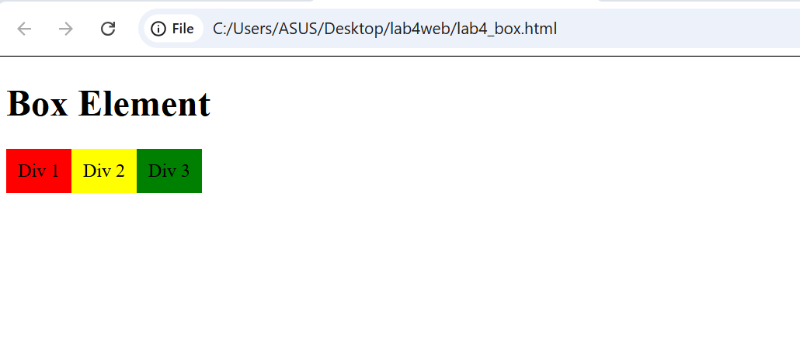
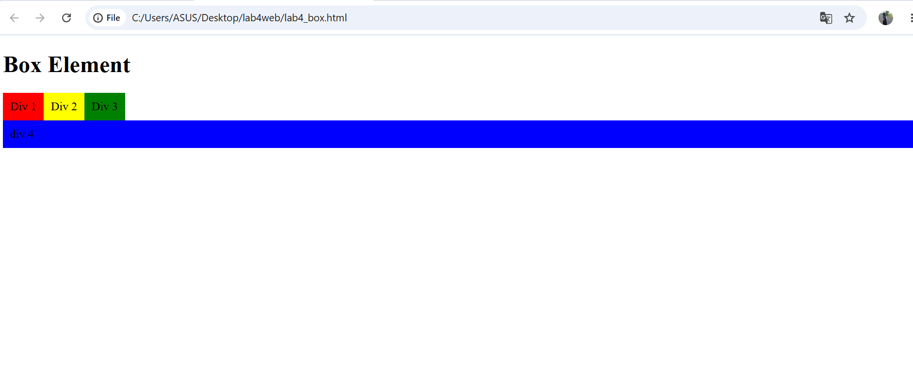

# Praktikum 4 — CSS Layout

## Identitas Mahasiswa
- Nama: Anzeni Nurul Zhiyah
- Program Studi: Teknik Informatika
- Mata Kuliah: Pemrograman Web

## 1. Praktikum Float
Praktikum ini mempelajari penggunaan properti `float` untuk mengatur posisi elemen.

## 2. Praktikum Clear
Properti `clear` digunakan untuk mengatur posisi elemen agar tidak terpengaruh oleh float.

## 3. Halaman Home
Halaman utama website Ruang Mahasiswa.

## 4. Halaman Artikel
Halaman yang berisi artikel dan informasi untuk mahasiswa.

## 5. Halaman About
Halaman yang menjelaskan informasi mengenai website.

## 6. Halaman Kontak
Halaman untuk menghubungi pengelola website.

## Kesimpulan
Praktikum ini membantu memahami penggunaan float, clear, serta pembuatan layout website menggunakan HTML dan CSS.